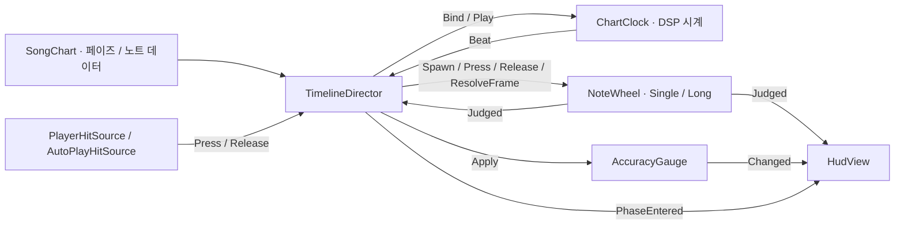

# Good Pizza, Great Rhythm (GPGR)


피자 조리 과정을 리듬 차트로 표현하는 Unity 2D 리듬 게임 프로토타입임.
원형 노트 휠에서 단타·롱노트를 판정하며, 자동 시연과 직접 플레이를 지원함.

## Demo / Preview

플레이 영상·GIF·스크린샷 추가 예정.

<!-- 미디어 추가 후 주석 해제 및 실제 파일 경로로 교체

-->

## Install & Usage

### 실행

1. Unity Hub에서 **Unity 6000.6.1f1** 설치함.
2. 저장소 Clone 실행: `git clone https://github.com/goldsw/Good_Pizza_Great_Rhythm_main.git` (ZIP 다운로드도 가능).
3. Unity Hub에서 `Assets`, `Packages`, `ProjectSettings`가 있는 프로젝트 루트를 추가·실행하고 패키지 복원과 에셋 임포트 완료까지 기다림.
4. **`Assets/GPGR/Scenes/Trailer.unity`**를 열고 **Play** 실행함.

포함된 데모는 **125 BPM · 7개 페이즈** 구성임. 차트의 Playback 설정에 따라 자동 시연 또는 직접 플레이로 시작함.

> 현재 빌드 씬 목록에는 빈 기본 씬인 `Assets/Scenes/SampleScene.unity`만 활성화되어 있음. 게임 실행에는 `Trailer` 씬을 사용하고, 독립 실행 빌드 시에도 해당 씬을 빌드 씬 목록에 추가·활성화 필요.

### 직접 플레이·조작

Play 종료 → `Assets/GPGR/Charts/DemoChart.asset` 선택 → Inspector의 **Playback을 Human으로 변경** → 다시 Play 실행함.

- `Space` / `Enter` / `Numpad Enter` / 마우스 좌클릭: 타격 입력. 롱노트는 누름·뗌 입력 사용함.
- `R`: 차트 재시작.
- `H`: HUD 표시 전환.
- `F`: 배경 모드 전환.

자동 시연으로 복귀하려면 같은 차트의 **Playback을 AutoPlay로 변경**함.

### 차트 제작

- **`GPGR > Chart Editor`**: `SongChart` 선택 후 곡·페이즈·노트 설정 편집 및 유효성 검사 가능.
- **`Assets > Create > GPGR > Song Chart`**: 새 차트 에셋 생성 가능.
- **`GPGR > Create Demo Chart Asset`**: 샘플 차트 생성 메뉴. 실행용 `DemoChart.asset`은 이미 포함되어 있음.

## Features & Architecture

### 기술 스택

- **엔진·언어**: Unity **6000.6.1f1**, C#.
- **렌더링**: Universal Render Pipeline **17.6.0**, 2D 스프라이트 기반 화면 구성.
- **입력**: Input System **1.20.0**. 플레이 타격은 `PlayerHitSource`가 키보드·마우스 상태를 직접 읽음.
- **UI**: Unity UI (uGUI) **2.6.0**. 페이즈명·판정 팝업·정확도 HUD 표시함.
- **테스트**: Unity Test Framework **1.8.0**, NUnit 기반 EditMode 테스트.
- **기타 설치 패키지**: Timeline **6.6.0**, 2D Animation **16.0.0**, Aseprite **6.0.0**, PSD Importer **15.0.0**. 차트 재생 시계는 자체 `ChartClock`으로 구현됨.

버전 기준: [ProjectVersion.txt](ProjectSettings/ProjectVersion.txt), [manifest.json](Packages/manifest.json), [packages-lock.json](Packages/packages-lock.json).

### 주요 시스템

- **조리 페이즈 데모**: 반죽 → 토마토 소스 → 치즈 뿌리기 → 페퍼로니 → 치즈 → 오븐 → 완성의 7단계 구성.
- **데이터 기반 차트**: `SongChart` ScriptableObject에 BPM·오디오·오프셋·판정창·재생 모드·페이즈 목록 보관함. 페이즈별 노트·배경·피자 상태·휠 색상·유지 박자 설정 가능.
- **음악·박자 동기화**: `ChartClock`이 오디오를 DSP 시각에 예약 재생하고, 경과 시간에 오프셋을 더해 beat로 환산함. 오디오 미지정 시 Unity 시간으로 진행함.
- **타임라인 진행**: `TimelineDirector`가 페이즈 전환·노트 스폰·입력 수집·판정·차트 종료를 조정함.
- **단타·롱노트 판정**: `NoteWheel`이 입력 가능한 노트 중 시간 오차가 가장 작은 대상을 선택함. `SingleNotePattern`과 `LongNotePattern`으로 입력 처리 분리함.
- **판정·정확도**: Perfect / Good / Bad / Miss 지원함. 기본 판정창은 ±50 / ±100 / ±160ms이며, 정확도는 100%에서 판정별 0 / 2 / 5 / 10%p 차감 후 0–100%로 제한함.
- **자동·수동 입력**: `AutoPlayHitSource`와 `PlayerHitSource`를 차트의 Playback 설정으로 전환함. 자동 입력은 seed와 Good 판정 비율 설정 지원함.
- **이벤트 기반 화면 갱신**: 페이즈·판정·정확도 이벤트로 HUD를 갱신하며, View 계층에서 노트 휠·배경·피자 연출 담당함.

### 주요 폴더

```text
Assets/
├─ GPGR/
│  ├─ Art/          # 게임 아트
│  ├─ Audio/        # 오디오 리소스
│  ├─ Charting/     # 차트·페이즈·노트 데이터, 판정창·배치 계산
│  │  └─ Tests/    # 차트·판정 EditMode 테스트
│  ├─ Charts/       # DemoChart 등 SongChart 에셋
│  ├─ EditorTools/  # 차트 편집 창·샘플 생성 도구
│  ├─ Prefabs/      # 재사용 게임 오브젝트
│  ├─ Runtime/      # 시계·진행·입력·노트 판정·정확도
│  │  └─ Tests/    # 자동 입력·판정 연결·모션 경로 테스트
│  ├─ Scenes/       # 실제 플레이용 Trailer 씬
│  └─ View/         # 화면 표시·HUD·연출·TrailerBootstrap
│     └─ Editor/   # 뷰 관련 에디터 도구
└─ Scenes/         # 기본 SampleScene
Packages/          # 패키지 선언·의존성 잠금
ProjectSettings/   # 엔진 버전·입력·빌드 등 프로젝트 설정
```

### 런타임 흐름



매 프레임 현재 beat 확인 → 종료 노트 제거 → 페이즈 진입·노트 스폰 → 입력 수집 → 판정 확정 → 차트 종료 확인 순으로 처리함.

주요 진입점: [TrailerBootstrap](Assets/GPGR/View/TrailerBootstrap.cs), [TimelineDirector](Assets/GPGR/Runtime/TimelineDirector.cs), [SongChart](Assets/GPGR/Charting/SongChart.cs).

### 검증

`Charting/Tests`와 `Runtime/Tests`에 판정 경계값·차트 배치·입력과 정확도 연결·자동 재생·시계·모션 경로 테스트 포함됨. Unity Test Runner에서 **EditMode** 테스트 실행 가능.

이 초안 작성 과정에서 Unity 실행·빌드·테스트는 수행하지 않았으며, CI 워크플로도 현재 포함되어 있지 않음. 상단 Build 배지는 미검증 상태를 표시함.

## Contributing & License

### Contributing

- 버그 제보·기능 제안은 Issue, 변경 제안은 Pull Request 사용 권장.
- 변경 목적·재현 방법·실행 씬·검증 결과 기재 권장.
- 차트·런타임 변경 시 관련 EditMode 테스트 확인 필요.

### License

현재 저장소에 `LICENSE` 파일이 없어 라이선스 미지정 상태임. 코드·아트·음원 사용 조건은 프로젝트 소유자 확인 필요.
