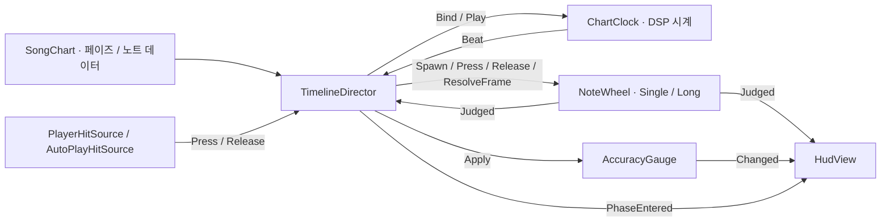

코드로 연결되는 상대 경로 링크와 Mermaid 다이어그램까지 포함되어 있어 완성도가 매우 높습니다. 기존 마크다운의 핵심 요소(파일 링크, Mermaid 차트, 주석)를 모두 유지하면서, 어색한 개조식 문체(`~임`, `~함`)와 AI 작업 보고 문구를 덜어내고 가독성을 높인 최종 편집본입니다.


# 🍕 Good Pizza, Great Rhythm (GPGR)


피자 조리 과정을 리듬 차트로 표현하는 Unity 2D 리듬 게임 프로토타입입니다.  
원형 노트 휠에서 단타·롱노트를 판정하며, 자동 시연(AutoPlay)과 직접 플레이(Human)를 모두 지원합니다.

## Demo / Preview

> 플레이 영상·GIF·스크린샷 추가 예정

<!-- 미디어 추가 후 주석 해제 및 실제 파일 경로로 교체

-->

## Install & Usage

### 실행 방법

1. Unity Hub에서 **Unity 6000.6.1f1** 버전을 설치합니다.
2. 저장소를 클론합니다. (ZIP 다운로드도 가능)
   ```bash
   git clone [https://github.com/goldsw/Good_Pizza_Great_Rhythm_main.git](https://github.com/goldsw/Good_Pizza_Great_Rhythm_main.git)


3. Unity Hub에서 `Assets`, `Packages`, `ProjectSettings`가 포함된 프로젝트 루트를 추가해 실행하고, 패키지 복원과 에셋 임포트가 완료될 때까지 기다립니다.
4. `Assets/GPGR/Scenes/Trailer.unity`를 열고 **Play** 버튼을 눌러 실행합니다.

포함된 데모는 **125 BPM · 7개 페이즈**로 구성되어 있으며, 차트의 `Playback` 설정에 따라 자동 시연 또는 직접 플레이로 시작합니다.

> **참고:** 현재 빌드 씬 목록에는 빈 기본 씬인 `Assets/Scenes/SampleScene.unity`만 활성화되어 있습니다. 게임 실행에는 `Trailer` 씬을 사용하며, 독립 실행 빌드 시에도 해당 씬을 빌드 씬 목록에 추가 및 활성화해야 합니다.

### 직접 플레이 및 조작법

직접 플레이하려면 Play를 종료한 뒤 `Assets/GPGR/Charts/DemoChart.asset`을 선택하고, Inspector에서 **Playback을 `Human`으로 변경**한 후 다시 Play를 실행합니다. (자동 시연으로 복귀하려면 **`AutoPlay`로 변경**)

| 입력 키 | 동작 설명 |
| --- | --- |
| `Space` / `Enter` / `Numpad Enter` / `마우스 좌클릭` | 타격 입력 (롱노트는 누름·뗌 입력 사용) |
| `R` | 차트 재시작 |
| `H` | HUD 표시 전환 |
| `F` | 배경 모드 전환 |

### 차트 제작 도구

* **`GPGR > Chart Editor`**: `SongChart` 선택 후 곡·페이즈·노트 설정 편집 및 유효성 검사
* **`Assets > Create > GPGR > Song Chart`**: 새 차트 에셋 생성
* **`GPGR > Create Demo Chart Asset`**: 샘플 차트 생성 메뉴 (실행용 `DemoChart.asset`은 이미 포함되어 있음)

## Features & Architecture

### 기술 스택

* **엔진·언어**: Unity **6000.6.1f1**, C#
* **렌더링**: Universal Render Pipeline **17.6.0** (2D 스프라이트 기반 화면 구성)
* **입력**: Input System **1.20.0** (`PlayerHitSource`가 키보드·마우스 상태를 직접 읽어 입력 처리)
* **UI**: Unity UI (uGUI) **2.6.0** (페이즈명·판정 팝업·정확도 HUD 표시)
* **테스트**: Unity Test Framework **1.8.0** (NUnit 기반 EditMode 테스트)
* **기타 설치 패키지**: Timeline **6.6.0**, 2D Animation **16.0.0**, Aseprite **6.0.0**, PSD Importer **15.0.0** (차트 재생 시계는 자체 `ChartClock`으로 구현)

버전 기준: [ProjectVersion.txt](https://www.google.com/search?q=ProjectSettings/ProjectVersion.txt), [manifest.json](https://www.google.com/search?q=Packages/manifest.json), [packages-lock.json](https://www.google.com/search?q=Packages/packages-lock.json)

### 주요 시스템

* **조리 페이즈 데모**: `반죽 → 토마토 소스 → 치즈 뿌리기 → 페퍼로니 → 치즈 → 오븐 → 완성`의 7단계 구성
* **데이터 기반 차트**: `SongChart` ScriptableObject에 BPM·오디오·오프셋·판정창·재생 모드·페이즈 목록을 보관하며, 페이즈별 노트·배경·피자 상태·휠 색상·유지 박자 설정 가능
* **음악·박자 동기화**: `ChartClock`이 오디오를 DSP 시각에 예약 재생하고, 경과 시간에 오프셋을 더해 `beat`로 환산 (오디오 미지정 시 Unity 시간으로 진행)
* **타임라인 진행**: `TimelineDirector`가 페이즈 전환·노트 스폰·입력 수집·판정·차트 종료를 총괄 조정
* **단타·롱노트 판정**: `NoteWheel`이 입력 가능한 노트 중 시간 오차가 가장 작은 대상을 선택하며, `SingleNotePattern`과 `LongNotePattern`으로 입력 처리를 분리
* **판정·정확도**: `Perfect / Good / Bad / Miss` 4단계 판정 지원 (기본 판정창: `±50 / ±100 / ±160ms`). 정확도는 100%에서 판정별 `0 / 2 / 5 / 10%p` 차감 후 `0–100%`로 제한
* **자동·수동 입력**: `AutoPlayHitSource`와 `PlayerHitSource`를 차트의 `Playback` 설정으로 전환 (자동 입력은 시드와 `Good` 판정 비율 설정 지원)
* **이벤트 기반 화면 갱신**: 페이즈·판정·정확도 이벤트로 HUD를 갱신하며, View 계층에서 노트 휠·배경·피자 연출을 독립적으로 담당

### 주요 폴더

```text
Assets/
├─ GPGR/
│  ├─ Art/          # 게임 아트
│  ├─ Audio/        # 오디오 리소스
│  ├─ Charting/     # 차트·페이즈·노트 데이터, 판정창·배치 계산
│  │  └─ Tests/    # 차트·판정 EditMode 테스트
│  ├─ Charts/       # DemoChart 등 SongChart 에셋
│  ├─ EditorTools/  # 차트 편집 창·샘플 생성 도구
│  ├─ Prefabs/      # 재사용 게임 오브젝트
│  ├─ Runtime/      # 시계·진행·입력·노트 판정·정확도
│  │  └─ Tests/    # 자동 입력·판정 연결·모션 경로 테스트
│  ├─ Scenes/       # 실제 플레이용 Trailer 씬
│  └─ View/         # 화면 표시·HUD·연출·TrailerBootstrap
│     └─ Editor/   # 뷰 관련 에디터 도구
└─ Scenes/         # 기본 SampleScene
Packages/          # 패키지 선언·의존성 잠금
ProjectSettings/   # 엔진 버전·입력·빌드 등 프로젝트 설정

```

### 런타임 흐름



매 프레임 **현재 beat 확인 → 종료 노트 제거 → 페이즈 진입·노트 스폰 → 입력 수집 → 판정 확정 → 차트 종료 확인** 순으로 처리합니다.

주요 진입점: [TrailerBootstrap](https://www.google.com/search?q=Assets/GPGR/View/TrailerBootstrap.cs), [TimelineDirector](https://www.google.com/search?q=Assets/GPGR/Runtime/TimelineDirector.cs), [SongChart](https://www.google.com/search?q=Assets/GPGR/Charting/SongChart.cs)

### 테스트 및 검증

* `Charting/Tests`와 `Runtime/Tests`에 판정 경계값, 차트 배치, 입력과 정확도 연결, 자동 재생, 시계, 모션 경로 테스트가 포함되어 있습니다.
* Unity 상단 메뉴의 **Test Runner**에서 **EditMode** 테스트를 실행해 검증할 수 있습니다.

## Contributing & License

### Contributing

* 버그 제보 및 기능 제안은 **Issue**, 코드 변경 제안은 **Pull Request** 사용을 권장합니다.
* PR 작성 시 변경 목적, 재현 방법, 실행 씬, 검증 결과를 함께 기재해 주세요.
* 차트 및 런타임 로직 변경 시 관련 **EditMode 테스트** 통과 여부를 확인해야 합니다.

### License

현재 저장소에 별도의 `LICENSE` 파일이 없어 라이선스 미지정 상태입니다. 코드·아트·음원 사용 조건은 프로젝트 소유자에게 문의해 주세요.

